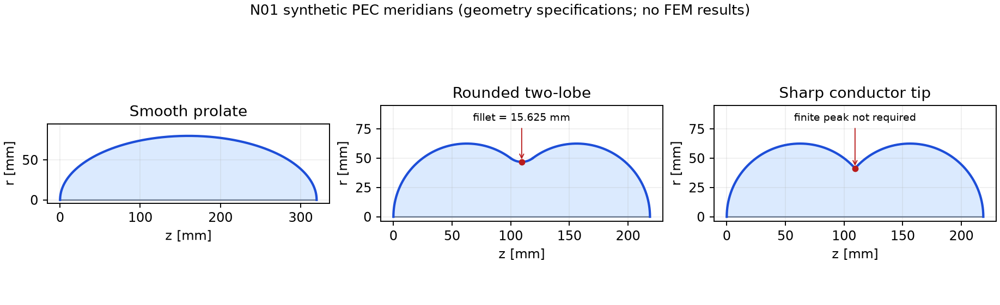

# N01：幾何・場・表面ピークの受入ケース仕様

2026-10-07。N01の仕様カードを受入し、N02の独立比較器とN03の実精度検証へ渡す。
元123カードと互換32要件を維持する。ここでのDONEは**仕様の完了**であり、
追加ケースのFEM収束・独立Maxwell照合・親G03/N03の受入を意味しない。
新FEM/unit/seed/full/legacy実行は0。

機械可読の全Case・15幾何入力・三水準計画・基準・参照状態は
[n01_geometry_surface_cases.json](n01_geometry_surface_cases.json)。
全ケースは合成形状、真空・閉PEC・軸接続m=0 TM、P2場/二次幾何、SI・peak phasor、
U=1 J、beta=1、sigma=5.8e7 S/m。実機測定/KEK/LANL形状へ読み替えない。
Caseの物理・全曲線・境界タグ・規格化・位相原点は各系列で固定する。

## 入力と基準値

各Caseの幾何3水準×各固定幾何FEM3水準（計画上9点）を評価する。
鋭角対照も全入力を残すが、滑らかな有限ピークの成功例へ数えない。
原成功例は過去の元成果物を保持し、再検証/新求解を別集計する。

| ID | 元寸法 [m] | 弦許容差3水準 [m] | 幾何/参照の位置付け |
|---|---|---|---|
| sphere-control | a=b=.08、L=.16 | .0016 / .0004 / .0001 | 既存球の独立解析成功を保持。SphereTMの場・f/RQ/G/境界ピークを参照 |
| ellipse-archive | a=.1、b=.08、L=.2 | .002 / .000125 / .00003125 | 既存の幾何3×FEM3の成功を保持。過去の1モード診断は独立Maxwell参照ではない |
| prolate-new | a=.16、b=.08、L=.32 | .0016 / .0004 / .0001 | 滑らかな非球形の追加系列。以前の固定P2適応対照とは別の幾何/FEM分離検証 |
| rounded-two-lobe | R=.0625、d=.046875、rho=.015625、L=.21875 | .0005 / .000125 / .00003125 | 接線連続の丸めた再入壁。喉半径 .046875。独立Maxwell参照は未取得 |
| sharp-two-lobe | 同じR/d/L、rhoなし | .0005 / .000125 / .00003125 | 導体先端角82.819度、真空内角277.181度の鋭角対照。有限ピークを要求しない |

a/bは軸/半径方向半軸。新Caseは3モードを計算し、初期順位をtarget/guard-2/guard-3と明示する。
対象は全保存場で確認された個別ID。geometry/FEM系列の順位一致だけで枝を選ばない。
球のtargetを解析l=1へ対応させるには、周波数だけでなく元E/H・境界条件も照合する。
未計算全スペクトルの分離を3モードで証明したとはしない。

初期最大辺長は球/長楕円体 .064 m、他 .02 m、角度下限5度、上限250000三角形/12 mesh rounds。
固定二次領域を元弦meshから保ち、uniform細分level 0/1/2を追加する。
予算不足・品質未達・未確認対応は未確認で保存する。閾値緩和で成功へ変えない。
予算拡大が必要なら、新規の明示計画/成果物として扱い、旧失敗と費用を残す。

## 独立幾何と丸め/鋭角の定義

球/楕円の子午面面積はpi*a*b/2、回転体積は4*pi*a*b²/3。
境界位置は元解析曲線と保存P2の補間余り＋節点丸めを別評価する。
楕円/円弧の幅hでは max(a,b)*abs(h)³/(72*sqrt(3)) と節点誤差の5/4倍が既存の位置上界。
その数式の範囲を引用し、新しい形式検証済み超越関数実装とは呼ばない。

二ローブは中心z=R/R+2d、半径Rの円で構成する。丸め円の中心は
(z,r)=(R+d,c)、c=sqrt((R+rho)²-d²)。接触角alpha=atan2(c,d)。
PECを右極から左極へ、右円[0,pi-alpha]、丸め円[-alpha,-pi+alpha]を時計回り、
左円[alpha,pi]の順で接続する。軸は[0,L]、全非軸辺はPEC。
理想形はC1で曲率が接続で切り替わる。メタデータは角度許容差1e-8内の接線一致を
確認するもので、厳密C2正則性や有限電磁ピークの証明ではない。

独立モーメントはnative曲線の積分関数を使わず、明示r(z)を積分する。
s=R*d/(R+rho)、左接点z=R+s、右接点z=R+2d-sとし、
左はsqrt(R²-(z-R)²)、中央はc-sqrt(rho²-(z-R-d)²)、右はsqrt(R²-(z-R-2d)²)。
A=integral(r dz)、V=pi*integral(r² dz)。sharpはz=R+dで左右円を直接つなぐ。
全Caseのnative面積/体積と、この別の積分・球/楕円閉形式が2e-12以内で一致する。

| ケース | 独立面積 [m²] | 独立体積 [m³] |
|---|---:|---:|
| sphere-control | .01005309649148734 | .0021446605848506324 |
| ellipse-archive | .012566370614359173 | .0026808257310632906 |
| prolate-new | .02010619298297468 | .004289321169701265 |
| rounded-two-lobe | .011422182094877349 | .001967633854523379 |
| sharp-two-lobe | .011386471783597606 | .0019574234012082396 |

roundedとsharpは別の物理形状。両者のピーク差を同一形状の収束差として使わない。
sharpにはSINGULAR_GEOMETRYを要求する。離散ピークが有限/安定に見えても合格へ変えない。
特定モードの特異係数や発散率をこの形状診断だけで断定しない。

## 数値の受入条件

[表面収束仕様](SURFACE_CONVERGENCE.md)の元五量を保持する。
各固定幾何の連続2 FEM区間**両方**と、各最細FEM同士の連続2幾何区間**両方**で判定する。
geometry/FEM/求積/代数残差/モード対応を互いの代用にしない。

| 量/条件 | 基準・根拠 |
|---|---|
| f | 相対差1e-4。表面収束の五量基準。Studyの一般f .001を代用しない |
| R/Q accelerator / G | 相対差 .005。両R/Qの名称・半値関係と全PEC壁積分を保持 |
| Epk/Eacc / Bpk/Eacc | ピーク上下界の最悪相対差 .01。単一推定値や片端の差だけで判定しない |
| 元場のpairing/軸Ez | [studies.compare_refinement](../src/superfish_ng/studies.py) のHphi重なり .98、競合差 .02、計算された近接比1e-6、軸相対L2 .01。既存楕円報告の判定を保持 |
| 新固定領域の個別ID | curved_same_domain、sample_order=10、overlap .98、assignment margin .05、relative_cluster_gap 1e-6、minimum_relative_singular_value 1e-8。全ID未確認なら停止 |
| 球の独立E/H場 | [球参照](SPHERE_REFERENCE.md)の体積重み付き内部点/軸場・単一符号、各相対L2 .01。既存有限サンプリングの範囲を保持 |
| 独立現代参照の内部E/H | [A01](A01_BACKEND_COMPARISON.md)の相対L2 .005、U=1 J/peak、一つの全体位相・符号だけを合わせる。適用領域/サンプルと参照側収束も別記 |
| 固定P2幾何 | 各FEM点で面積/体積不変、ネスト関係が成立する親子のみRitz検査。別geometryのRitz順序は要求しない |
| 幾何不変量 | 位置上界・面積/体積の独立誤差が連続2区間で減少。既存最終モーメント目標1e-5を保持 |
| 求積 | 同じ保存場で12/16/24次の整合を別報告。元専用基準1e-8。wall積分は8/16次も照合。追加eigsolveへ数えない |

古いpairingのcommon-domain sampleは全領域のL2誤差保証ではない。
N02はサンプル位置・重み・領域被覆/欠測・対応順位を保存し、欠測を黙って削除して全場一致と書かない。
Eacc有意性/正の区間下界/有限表現/個別IDが欠けた量はUNVERIFIED。
鋭角対照は有限ピークゲートを適用しないが、SINGULAR_GEOMETRYという判定自体を検査する。

## 参照の独立性と入手経路

球の解析参照は元FEMの場や固有値を一切係数にしないSphereTM。
球/楕円の受入済み旧report4件は現存しPASSとSHAを照合した。
楕円の最細五量区間はcatalogのhistorical_ng_baselineへ固定し、独立参照へ流用しない。
過去の1モード・別min-angleの元Caseは保持する。3モード/5度の新入力を過去の結果で受入したとはしない。

非球形/丸めの独立Maxwell/物理ピーク値は現時点でnull/UNVERIFIED。
N02/N03は[A01の固定cavsim2d commitと隔離環境](A01_BACKEND_COMPARISON.md)を第一候補とする。
元LICENSE/79選択source SHAと依存版を確認し、必要ならuvで隔離環境を復元する。
製品依存にNGSolve/Gmshを追加しない。元全曲線・axis/PECタグ・領域/壁・規約を表せることを先に検証する。
以前に検証したpolygon APIが楕円/丸めも扱えるとは仮定しない。

独自E空間/独立meshで両側3水準を求解し、同じ完全解析境界を用いる。
共通のNumPy/SciPy・物理定数・浮動小数点基盤も記録し、完全に独立したスタックとはしない。
同じ多角形/二次近似境界だけを参照へ渡した場合は、その近似領域の比較として表示する。
ピークは参照の連続/離散/囲い込み/サンプル推定の違いを保持する。
サンプル最大だけしか得られない参照を、独立物理ピークの合格根拠にしない。

許可済みWine black-boxは代替経路だが、環境/対象版規約/同じ全曲線入力が確認できた場合だけ。
旧source/binary内部を読まず、入力・設定・数値出力をignored outへ保存する。
参照環境/対応曲線/規約が欠けた場合は未取得理由を残す。自作NGの最細解を独立参照へ昇格しない。
自己収束に合格しても物理参照行の未確認を消さない。

## 今回の受入と次工程

五Caseのstrict解析・全15幾何入力の物理不変・独立モーメント・滑らか/特異診断をmetadataだけで確認した。
三水準×三水準の新FEM実行はN03。実行器の入力一般化・故意の未収束/場不一致/参照欠落はN02。
現在の[geometry_surface validator](../scripts/validate_geometry_surface_convergence.py)は旧楕円archive専用であり、
このcatalogを既に受け付ける実装があるとは書かない。
旧報告・この仕様・新数値受入を別記し、文書のためのFEM/全suiteを実行しない。

初稿 R=.06/d=.045/rho=.01 は端点の分離方向の微小な重なりで厳密parserがUNVERIFIEDとして拒否した。
`metadata.log`、`initial-catalog-builder.py`と原寸法を保全した。
物理/FEMの閾値や幾何検査は変更せず、上記の別の明示寸法を選び、既存strict parserへ適合させた。
最終metadataは0.504秒、終了0。診断helperのsplit_curve import誤記も修正した。
全1190 Python源は不変、旧成果物はSHA不変、新FEM/unit/seed/full/legacy0。
形状図は元解析曲線のmetadataから作成し、画像を目視確認した。新依存・外部資料・legacy内部参照はなし。
rawは `out/n01-geometry-surface-cases-20261007/`。N01 DONE後も親G03/N03、全goalは継続する。
