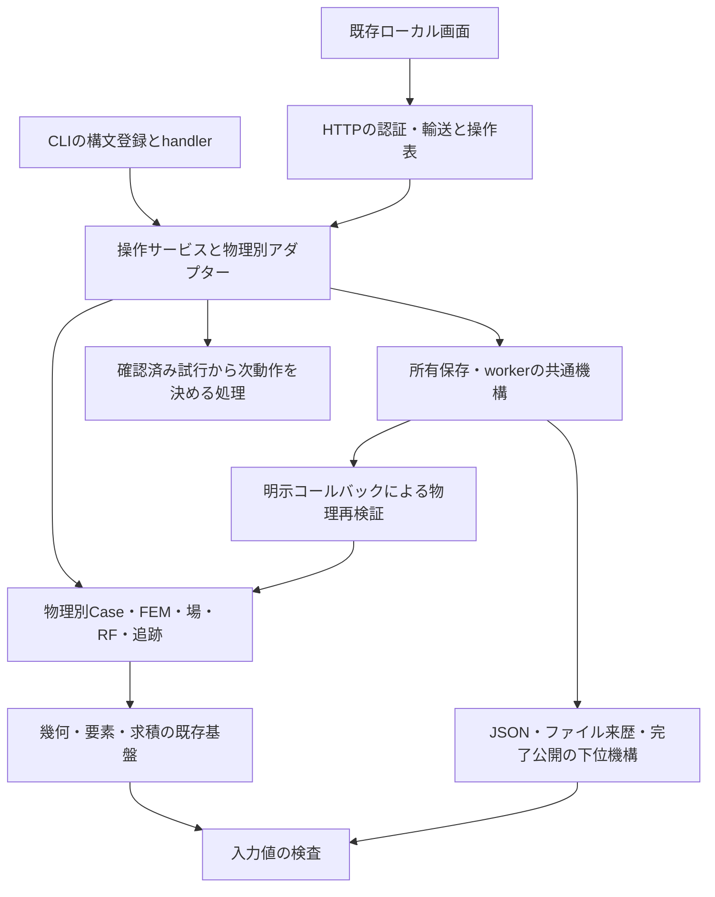

# 既存実装のリファクタリング計画

作成：2026-09-22。更新：2026-10-13。[横断レビュー](IMPLEMENTATION_REVIEW_2026-09-22.md)
（基準`a191b4e`）のF01〜F10と、[科学レビュー](SCIENTIFIC_REVIEW_2026-10-13.md)
（基準`4665561`）のS01〜S06を対応させる。**RF-11/RF-01/RF-09を受入済み。残8枚は未着手で、計画全体は継続中。**
既存IDを保つ`RF-01`〜`RF-10`と、新規不具合対応`RF-11`を
[開発計画](development-plan/README.md)・[tasks.tsv](development-plan/tasks.tsv)へ登録する。
原141カードの状態を維持し、11枚をPLANNEDで追加した全152カードを実行対象とする。
着手順の正本は引き続き[CURRENT](development-plan/CURRENT.md)。

## 目的と変更しない契約

目的は、共通の修正を一箇所で検証できるようにし、物理追加時の変更範囲と検証費用を抑えること。
F01/F02とS01の修正は振舞いを変える不具合対応として、振舞いを保つ責務分離から分ける。
FEM核の書換え、全面的なディレクトリ移動、物理別Solutionの統一、依存追加、GUIフレームワーク
導入はこの計画の前提にしない。既存の小さいモジュールはその責務が明確なら維持する。

全カードで以下を保持する。

| 境界 | 固定するもの |
| --- | --- |
| 物理 | canonical真空/閉PEC/軸接続m=0 TM、専用TE/平面/Hφ/材料/静的場の明示した範囲、未対応条件の拒否 |
| 数値 | 元のFEM、求積、自由度、静的核の除外、規格化、物理許容差。解析式による代替や結果補正を入れない |
| 単位/量 | SI、peak phasor、TMの両R/Q、平面のJ/m、TE等のN/A、加速座標と元RF全量 |
| 追跡 | 周波数順位と個別ID/集合IDの区別、guard、真の縮退での未確認、回復anchorと比較親の区別 |
| 保存 | format/schema/kind、既存reader、排他出力、最後の完了公開、所有コピー、全prefix、改変/リンク拒否 |
| 操作 | 公開関数signature、CLI名/引数/終了コード、HTTP認証/許可キー/サイズ、worker中止/再起動/別job再開 |
| 証拠 | 失敗/未確認の履歴、実行範囲、元場/入力/参照の来歴。部分検証を全受入へ読み替えない |

保存済み入力を読めることと、新規出力の全bytes一致は別条件である。
日時・環境・実装hashは変わり得るため、比較では明示した来歴項目だけを区別し、
元nativeコピーのbytes、canonical入力hash、場/RF/判断の不変性を個別に確認する。
schemaを変える必要が生じたら、この計画の機械的抽出に混ぜず、仕様カードへ分離する。

## 目標とする責務の方向



図は依存の目標であり、新しいpackage階層を一括作成する指示ではない。
`input_validation.py`、`json_codec.py`、`artifact_provenance.py`、`tuning_decision.py`等は候補名。
下位共通モジュールはCLI/GUI/jobs/特定物理のProjectや保存readerをimportしない。
コールバックは呼出元が明示し、kindやファイル名から未宣言の物理を推測しない。
幾何の有理数証明と浮動小数点積分、真空と材料の重みを同じ処理へ強引に統合しない。

## 順序と区切り

### 科学レビューを受けた実装計画への挿入位置

進行中のADD-N04-rf-goal-04は完了済みprefixと失敗記録を保全し、実行中処理の終端と
ソース固定の解除を確認したコミット境界で、**RF-11→RF-01**を先に実施する。
04の全完了まで先送りせず、次の固定36実行（ADD-N04-rf-goal-05）や新しい長時間受入の前に置く。
その後RF-09で現行仕様を整理し、RF-02→RF-03へ進む。
RF-04/05/08は次に触る所有保存・調整経路と一緒に小さく移行し、RF-06/07を操作受入前、
RF-10を移行後の費用監査に置く。既存機能の不足分をこの抽出で受入済みにしない。

| 科学レビュー | 計画での対応 | 完了時にも保つ区別 |
| --- | --- | --- |
| S01 入力と実解の不一致 | RF-11を最初の修正カードへ追加 | 求解契約と変更可能な後処理条件、保存hashと物理整合 |
| S02 検証中のソース固定 | RF-01の失敗条件を必須化 | 前後監査済みの専用証拠と旧総合記録 |
| S03 量ごとの精度 | RF-11/08と全カードの検証条件 | f、元E/H、RF、表面量を別判定。残差を精度の代用にしない |
| S04 曲線・求積・IDの限定保証 | RF-04/05/08の互換条件 | 固定P2領域と解析境界、有限guardと連続物理誤差 |
| S05 実測・不確かさ不足 | 既存L06/L07とV05で継続 | リファクタリングや合成例では実機検証を完了にしない |
| S06 古い現在形の仕様 | RF-09を初期工程へ移動 | 現行仕様の版・入口と日付付き受入履歴 |

RF-11/01はADD-N04-rf-goal-05の追加先行条件、RF-11/02/06/07/09はV02の追加先行条件とする。
V03はRF-07/08/09/10を待つ（その依存を含め全11枚を網羅）、V05で全11枚の条件別証拠を監査する。
これは2026-10-13のユーザー指示による品質工程の追加であり、L05の対象版調査を待つ機能追加ではない。

| カード | 対応所見 | 先行条件 | 変更単位の目安 | 状態 |
| --- | --- | --- | --- | --- |
| RF-11 入力・解の対応 | S01/S03 | なし | 求解契約と後処理条件を分離し、RF/保存/読込へ接続 | DONE |
| RF-01 検証来歴 | F01/S02 | RF-11 | validatorの来歴とその失敗検査 | DONE |
| RF-02 環境/任意依存 | F02/F08 | RF-01 | core/GUI条件、導入手順、環境証拠 | PLANNED |
| RF-03 下位共通処理 | F03 | RF-01/02 | 入力、JSON、来歴を別々に抽出 | PLANNED |
| RF-04 所有worker | F04 | RF-03 | 直線→曲線→材料の順で移行し、最後に統合確認 | PLANNED |
| RF-05 調整決定 | F05 | RF-03 | 決定の抽出→各物理アダプター移行 | PLANNED |
| RF-06 CLI分割 | F06 | RF-03 | 一つのコマンド群ずつ。RF-04/05の対象群はその移行後 | PLANNED |
| RF-07 HTTP/画面分割 | F06 | RF-04、RF-06 | HTTP輸送/操作表→一つの画面状態群ずつ | PLANNED |
| RF-08 テスト境界 | F07 | RF-03 | 変更する領域のfixture/入力/実FEM操作を分離 | PLANNED |
| RF-09 現行構成の索引 | F09/S06 | なし。実行順はRF-01直後 | 現行仕様と履歴を分け、各抽出時に更新 | DONE |
| RF-10 再生費用 | F10 | RF-04/05/08 | 測定1件→効果が確認できた箇所のみ改善 | PLANNED |

開始順はRF-11→RF-01→RF-09→RF-02→RF-03。RF-03以降は共通層の利用側を一度に全て移さず、
旧importを転送する互換関数を残して一つの経路ずつ移す。
依存がないカードも複数エージェントの同時作業指示ではない。
納期や速度改善率は未見積りであり、現時点の行数から算出しない。

## カードごとの実施条件

<a id="rf-11"></a>

### RF-11：求解契約と後処理条件を分け、入力と実解の対応を検証する

2026-10-13 **DONE**：[受入と保存版の扱い](AFFINE_SOLUTION_CONTRACT.md)。67個別unit・seed前後監査とf/全RF比較を記録。新runtime契約だけを追加し、結果schema 1/完了protocol 1は維持する。

親課題：O01/V02。対象：`solver.py:Solution/_solve`、`rf.py:quantities`、
`io.py:save_run`、`saved.py:read_solution`、`symmetry.py:reflect_solution`と直接消費者。
コミット件名案：`fix: 直線TMの入力と解の対応をRF評価と保存で検証する`。
既存`source_case`は鏡映元の意味も持つため、その上書きだけで通常解の求解契約を表さない。

最初に科学レビューS01の半径・長さ・9 J差替えをP1/P2の公開APIで再現し、
Caseの領域と実メッシュ、指定Uと実場積分の一致という独立条件が破れることを確認する。
P2長さ差替えは現状でも拒否されるので、新規再現失敗と数えない。
修正は次の責務を一つの直線TM経路から接続する。

- 求解側は物理モデル、宣言形状、境界役割、要素/幾何次数、実メッシュと正規化を、
  呼出元の可変dictから切り離した求解契約として保持する。鏡映は元半領域と導出全領域を明示する。
- 共通の照合処理はこの契約を使い、RF評価と完了保存の前に不一致を拒否する。
  β、導電率、電圧区間・位相原点・有効長は後処理条件として別に検査する。
  区間が実軸領域内であることを確認し、全Case一致の強制で正当な変更を壊さない。
- readerは通常生成/外部メッシュ/鏡映を区別し、宣言領域・全境界役割・次数・正規化と
  実配列を照合する。hashが通っても物理的に矛盾する旧成果物は理由付きで拒否する。
  再求解や解析周波数による補正は使わない。新保存項目が必要なら版/旧readerの扱いを
  実装前に同カードの仕様として固定し、RF-03の機械的抽出に混ぜない。

受入：P1/P2の三差替えをRF評価・保存で拒否し、既存の不整合成果物もreaderで拒否する。
不正保存は完了マーカーを公開しない。正しい旧保存と新規保存は読め、正当な後処理変更、
鏡映のU/Pの2倍・f/Q/G不変、外部メッシュの領域/タグ対応を保つ。
独立Bessel場・体積エネルギー・軸電圧・壁積分でf/元E/H/両R/Q/G/表面量を別確認する。
新たな許容差の緩和やレビューの不整合出力を正しいfixtureにする変更は不可。

検査の出発点：`test_physics`（β変更・正規化/導電率尺度則）、`test_accelerating_conventions`、
`test_saved`、`test_quadratic_rf`、`test_quadratic_storage`、`test_symmetry`、
`test_mesh_input`、`test_save_completion`から直接影響するケースを選び、差替え拒否を追加する。
seed TMの公開RF/保存経路に影響するのでseed validatorを実行し、fと全RFをbenchmarkと比較する。
全件は影響を限定できない場合か後続V03で一度行い、S01再現のためにレビュー全92件を回し直さない。

撤回：求解契約と全照合入口を一組で戻す。新旧成果物の扱いを明記し、不整合結果を受入へ戻さない。

<a id="rf-01"></a>

### RF-01：総合validatorのソース固定を検査する

2026-10-13 **DONE**：[受入と監査範囲](VALIDATOR_SOURCE_AUDIT.md)。7個別unit、元数値/CLIのAST一致、失敗時の終端reportを記録。新方式の実full監査は次の広範統合/節目に行う。

対象：`scripts/validate.py`、必要な専用runner検査、TESTING/PARALLEL_VALIDATION。
参考：`scripts/seminar_suite.py`の既存前後照合。

最初に、一時的なfixtureツリーと軽量な子コマンドを使い、実行途中に対象ファイルを
変更/追加/削除しても現状では最終hashしか残らないことを再現する。
製品作業ツリーを実際のfull計算中に改変する必要はない。
開始時/終了時の対象一覧・hashと差分を記録し、違いがあれば非ゼロ終了かつ受入不可にする。
通常の数値ゲート、`--skip-tests`の範囲表示、失敗ログ保持を変えない。

受入：無変更、内容変更、追加、削除、子コマンド失敗、skip-testsの報告を検査。
既存`test_parallel_test_runner`の失敗伝播/収集契約へ影響する箇所だけを確認する。
solver不変のため、このカード単独で全物理の再計算を要求しない。
次の広範変更/節目のfull検証で実際の不変hash記録を確認する。

撤回：validatorと報告readerの変更を同時に戻す。未検出の旧記録を新方式の証拠に変換しない。

<a id="rf-02"></a>

### RF-02：coreとGUIの検証環境を明示する

対象：`.github/workflows/ci.yml`、README、DEPENDENCIES、必要な依存定義/テスト条件。
F02の失敗再現を起点に、core利用時とGUI利用時の依存契約を固定する。
uvを使い、現開発環境・納品時benchmark再現・サポートPython版を区別した手順を記す。
既存requirementsは過去の版の証拠として保持する。

採用する構成：coreのみの導入/非GUI操作確認と、`plot`を含む受入環境を区別する。
GUIを含むfull検証には`plot`を導入し、core環境のGUI起動は説明付き拒否を確認する。
Python 3.10/3.12の依存解決は別々に確認し、現環境の版を一律に下限環境へ押し付けない。
lockを追加する場合は依存更新と分けて差分を審査し、将来のrunnerを固定する。

受入：Matplotlib不在時の明示拒否とcore操作、存在時のF02対象HTTPテスト、wheelからのGUI資産読込。
依存そのものが変わる場合、関連独立物理検査とfull validatorを一度実行する。
環境を取得できない版は未実行として残す。Hosted CIは観測したrunだけを受入記録にする。

撤回：依存解決ファイル/CI/導入説明を一組で戻す。旧benchmarkファイルを更新しない。

<a id="rf-03"></a>

### RF-03：入力検査、JSON、来歴を下位へ抽出する

対象：`config.py`の`keys/integer/positive`、`project.py:parse_json`、
`saved_mode_tracking.py:_canonical`、`jobs.py`のhash/JSON書込補助と直接の利用側。
`completion.py`は既存資産として再利用可否を確認する。

三段階に分ける。最初は値検査、次はJSON/canonical直列化、最後は来歴/ファイル補助。
それぞれ旧APIから転送し、まずTM入力と一つの専用物理で旧新一致を確認する。
NaN/Infinityの扱い、boolとint、重複キー、キー順、`-0.0`、文字encoding、例外を
単なる移動と同時に変更しない。不整合が見つかった場合は別の振舞い変更として再現・修正する。

受入：`test_interface`の入力ケース、`test_project`、`test_model_contract`等の直接消費者、
物理別strict parser、canonical hash/往復、`test_save_completion`の影響箇所。
抽出先が上位のCase/Project/jobs/GUIをimportしないことを確認する。
旧保存・v1/v2/v3入力のhashを保つ。共有範囲が広がった統合時はfull検証を一度行う。

撤回：抽出先への転送単位で戻せるよう、関数移動と全呼出元の改名を一括しない。

<a id="rf-04"></a>

### RF-04：Hφの所有worker機構を共通化する

対象：`hphi_tuning_jobs.py`、`curved_hphi_tuning_jobs.py`、`material_hphi_tuning_jobs.py`を最初の範囲とする。
tracking/history/GUIの同形処理はこの3経路の成立後に別コミットで検討する。

明示する共通契約はファイル名/kind、所有範囲、状態、snapshot、manifest、prefix検証。
物理固有のsubmission検査、元nativeの再生、試行実行は名前付きのコールバックとして渡す。
一つの万能基底クラスや、全保存形式を変更する新しいmanifestは導入しない。
曲線の初期checkpoint等、既存の差を3系の対応表にしてから抽出する。

受入：各`test_*hphi_tuning_jobs`の実pause/resume、cancel、manager再作成、失敗prefix、
元出力移動、kind差替え/改変/リンク拒否。関連saved/GUIの保存地点選択も確認する。
元native/Projectはbyte一致、全RFと判断履歴は一致、異なる物理の入力は拒否する。
worker wrapperだけの変更なら数値全validatorを一律追加しないが、共通JobManagerまで
変更が及び影響が限定できない場合はfull検証へ広げる。

撤回：物理ごとの呼出を旧実装へ戻せる順序で移行する。読めなくなるcheckpointを生成しない。

<a id="rf-05"></a>

### RF-05：確認済み試行から次動作を決める処理を分離する

対象：`tuning.py:_decision`と、planar/直線Hφ/曲線Hφ/材料Hφの呼出元。
要求の物理別正規化と`base_request`は入口側に置き、共通決定はファイル/solverへ依存させない。
入力はbracket制御値、確認済み試行の状態/値/周波数誤差/親、出力は停止状態か次試行。
既存のdictを外部契約として残し、内部の小さな型定義は必要な範囲だけ導入する。

受入：現行結果との比較でINITIAL/PAUSED/UNVERIFIED、未bracket、反復/パラメータ上限、
目標到達、最終細分失敗/成功、MESH_LIMITの各経路と親indexを固定する。
`test_tuning`、`test_hphi_tuning`の両周波数ゲート、各専用tuning/回復テストの直接影響先を選ぶ。
矩形の解析cutoff、同軸TEM/順位交換、材料の独立二層参照、曲線の既存尺度/元場検査を維持する。
未確認試行を「周波数あり」の共通入力へ変換してはならない。

撤回：各物理の決定呼出だけを旧関数へ戻す。記録済みtrial/decisionのschemaは維持する。

<a id="rf-06"></a>

### RF-06：CLIの登録と実行をコマンド群ごとに分割する

対象：`cli.py`。最初は一つのrun/replay/resume群を移し、他のコマンドはそのまま残す。
明示した`register_arguments`と`execute`相当の責務を置き、`main`は構文選択、実行、
既存の例外/終了コード変換を担当する。動的なモジュール探索は使わない。

受入：既存の公開コマンド/option/default/必須引数、helpの意味、正常/非成功/入力失敗の
終了コード、JSON stdout、上書き拒否を保持する。
`test_interface`、該当tuning CLI/保存テスト、`test_capability_inventory`の
`test_cli_inventory_matches_api_and_commands_are_real`を選ぶ。
全コマンド名と引数構成の機械比較は安価に行い、全solverの再実行とは分ける。

撤回：群単位で旧handlerへ戻す。入口の`superfish_ng.cli:main`は変更しない。

<a id="rf-07"></a>

### RF-07：HTTP輸送と画面状態を業務操作から分離する

対象：`gui.py`、関連`gui_*`、`web/app.js`。既存の専用画面を活用する。
最初はHTTP認証/応答/サイズ制限を固定し、操作名・許可キー・handlerを明示表で結び付ける。
次に共有JSの一つのworkflowだけを状態/DOM/要求変換へ分割する。
パッケージ資産とHTTPの許可パスを一緒に更新する。ビルドツールやWeb依存は増やさない。

受入：`test_gui_request_size`、F02対象の実HTTP認証/strict操作、該当GUIテストと
その操作の既存`verify_gui_*.mjs`を選ぶ。中止・再起動・保存地点選択を扱う変更なら
その実操作を省略しない。新しいJS資産はwheel展開後も読めることを確認する。
要求format/各物理の型を保持し、名前が似る操作を同じ物理処理へまとめない。

撤回：操作表/handler/JS資産を一群で戻す。旧入力/保存結果の変換は不要な構成とする。

<a id="rf-08"></a>

### RF-08：fixtureと独立参照、入力検査と実FEM検査を分ける

対象は次に変更する一領域から選ぶ。初候補はHφ worker群またはstatic Study群。
`tests/support/`相当へ移すのは再利用する形状/要求生成等であり、テスト間importを削減する。
`scripts/*reference.py`の独立参照は製品の新しい共通数値helperへ依存させない。

受入：移行前後の全test ID対応（改名時は対応表）、期待値/拒否条件/対象形式の維持、
既存runnerの収集/skip/失敗伝播を確認する。
入力の全形式網羅と、代表操作の状態遷移、物理ごとの全量比較を別々に指定できるようにする。
削る重複実行ごとに同じ失敗を引き続き検出するテストを示す。
時間を比較する場合は同じ環境/BLAS/worker数で測り、未測定の速度改善を完了条件にしない。

撤回：fixture移動/テスト分割を小単位で戻す。テスト削除だけのコミットを作らない。

<a id="rf-09"></a>

### RF-09：現行アーキテクチャと物理入口の索引を更新する

2026-10-13 **DONE**：[現行の入口索引と確認範囲](ARCHITECTURE.md#current-architecture)。PHYSICS §4/§7を版付きの公開適応・離散ピーク・N03/P07限定受入へ対応。163ローカルリンクと33モジュールの実在symbol、静的11種・日付付き履歴保持、全1488源byte不変を確認。文書だけで新FEM/unit/seed/full/GUI0、元失敗・一般誤差上界/実機未確認を保持する。

対象：ARCHITECTURE、PHYSICSの入口/対象範囲、README、CURRENTからのリンク。
まず現行実装を記載し、未実装のこの計画を実装済み構成図として掲示しない。
各物理についてCase/solve/場/量/native/操作/専用仕様・受入文書を対応させる。
canonical本文の「未対応」はどの入口に対する制限か明示する。
科学レビューS06のPHYSICS§4/§7を最初の対象とし、N08の公開適応経路、
直線/曲線の離散ピーク契約、N03/P07の限定受入を現行の版・入口へ対応させる。
現在形の未受入記述を修正しても、一般物理の誤差上界や実機検証まで受入範囲を広げない。

受入：ソースに実在する入口とリンク、専用仕様の版/単位/対象外との一致。
履歴の失敗や限定受入を削除せず、旧記録を現在の状態として読ませない。
B04のCURRENTを継続使用し、新しい進捗正本や三重追記を導入しない。
文書のみなので数値validator/full suiteは不要。

撤回：入口/索引の差分だけを戻す。専用受入証拠や原計画の状態は変更しない。

<a id="rf-10"></a>

### RF-10：履歴再生の費用を測り、根拠がある箇所だけ改善する

対象：planar tuningのprefix組立、Hφのcheckpoint再生/worker完了検証。
最初の成果は履歴長・自由度・mode数と、壁時間/RSS/hash読取量/行列組立・replay回数の表。
3段階以上の履歴長で、cold/warmの条件と成功/未確認/中止prefixを区別する。

測定で累積再生が支配的だった場合に限り、所有bytesと実装/要求/比較規約に結び付いた
実行内の検証済み状態を再利用する。外部ファイルの読み直し、再起動、要求変更で無効化する。
永続的にhashだけを信頼するキャッシュや、未確認場を確認済みにする近道は入れない。

受入：元場/全RF/ID/停止判断が旧実装と一致し、bytes/要求/親を変更した場合は再検証/拒否する。
測定した条件で時間/メモリの効果と不利を記録する。効果がなければ改善実装は見送り、
測定結果のみでカードを閉じてよい。一般の精度/性能保証へ拡張しない。

撤回：実行内再利用を外し、既存の全再生へ戻せるようにする。

## 検証の実施方法と完了判断

各カード開始時に[TESTING](TESTING.md)と直接の呼出元を照合する。
上記のtest名は選択の入口であり、全メソッドを毎回一括実行する指示ではない。
既存環境でのランナー例は以下。`tests`を検索パスに加える必要は現行helper依存のためである。

```bash
OPENBLAS_NUM_THREADS=1 UV_CACHE_DIR=/tmp/superfish-refactor-uv-cache \
PYTHONPATH=src:tests uv run --offline --no-project --python 3.12 \
  python -m unittest -v <選択したmoduleまたはclass.method>
```

数値修正/拡張が必要になった場合は、変更前に独立解析/物理不変量の失敗を確認する。
機械的な責務移動では入力・配列・RF・判断の旧新一致を基本とし、数値経路に影響する場合は
独立物理検査を併用する。seed TMに影響すればseedのfと全RFをbenchmarkと比較する。
共通層の広範な統合、依存変更、節目ではfull validatorを一度実行し、その直前に同じ全件
unittest discoveryを重ねない。変更のない後続文書作業では適用可能な成功証拠を再利用する。

各カードの完了記録には、移行した呼出元、保持したAPI/schema、不変量、実行した検査と範囲、
失敗/未確認、性能主張の有無を記す。一つの責務移動とその検査をcoherentなローカルコミットにする。
性能/数値許容差の変更、保存形式変更、全面フォーマット変更を同じコミットへ混ぜない。

計画全体の完了条件は、S01/F01/F02への対応、抽出対象の依存方向と所有/決定/操作契約の成立、
必要な検証と現行索引の更新である。行数/ファイル数/全体の循環数だけで成否を判断しない。
未移行の経路は明示し、既存機能カードの機能/互換受入をこの計画の完了で代替しない。

2026-10-13の計画組込みは文書のみ。既存141行の状態/文書/題名保持、全152ID・文書パス・依存と
循環なし、追加11節と新規リンク、V03/V05の全RF網羅、RF-11の検査候補8モジュールの実在、
`git diff --check`を静的確認しPASS。実行には既存環境の`uv run --offline --no-sync python`を使用した。
製品コード・許容差・既存受入証拠は変更せず、FEM/unittest/seed/full/GUIは実行しない。
新規外部資料・依存・旧資産の利用はない。上記の検査は後続実装時の受入条件である。
