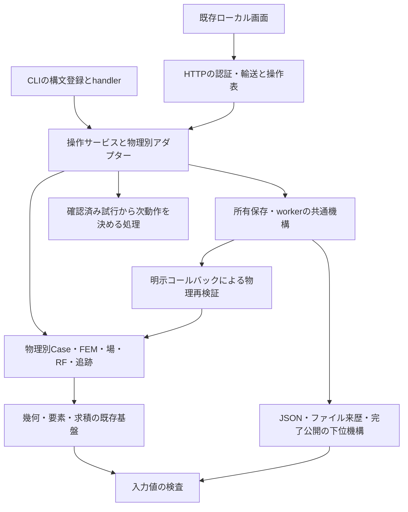

# 既存実装のリファクタリング計画

作成：2026-09-22。基準：`a191b4e`。[横断レビュー](IMPLEMENTATION_REVIEW_2026-09-22.md)の
F01〜F10を対象とする。**本計画は文書化済み、実装修正は全件未着手。**
既存の[開発計画](development-plan/README.md)115カードの追加機能/互換受入と混同しないため、
別名前空間`RF-01`〜`RF-10`を使う。`tasks.tsv`や親課題の受入状態は今回変更しない。
現在の機能開発の入口は引き続き[CURRENT](development-plan/CURRENT.md)。

## 目的と変更しない契約

目的は、共通の修正を一箇所で検証できるようにし、物理追加時の変更範囲と検証費用を抑えること。
F01/F02の修正は振舞いを変える不具合対応として、振舞いを保つ責務分離から分ける。
FEM核の書換え、全面的なディレクトリ移動、物理別Solutionの統一、依存追加、GUIフレームワーク
導入はこの計画の前提にしない。既存の小さいモジュールはその責務が明確なら維持する。

全カードで以下を保持する。

| 境界 | 固定するもの |
| --- | --- |
| 物理 | canonical真空/閉PEC/軸接続m=0 TM、専用TE/平面/Hφ/材料/静的場の明示した範囲、未対応条件の拒否 |
| 数値 | 元のFEM、求積、自由度、静的核の除外、規格化、物理許容差。解析式による代替や結果補正を入れない |
| 単位/量 | SI、peak phasor、TMの両R/Q、平面のJ/m、TE等のN/A、加速座標と元RF全量 |
| 追跡 | 周波数順位と個別ID/集合IDの区別、guard、真の縮退での未確認、回復anchorと比較親の区別 |
| 保存 | format/schema/kind、既存reader、排他出力、最後の完了公開、所有コピー、全prefix、改変/リンク拒否 |
| 操作 | 公開関数signature、CLI名/引数/終了コード、HTTP認証/許可キー/サイズ、worker中止/再起動/別job再開 |
| 証拠 | 失敗/未確認の履歴、実行範囲、元場/入力/参照の来歴。部分検証を全受入へ読み替えない |

保存済み入力を読めることと、新規出力の全bytes一致は別条件である。
日時・環境・実装hashは変わり得るため、比較では明示した来歴項目だけを区別し、
元nativeコピーのbytes、canonical入力hash、場/RF/判断の不変性を個別に確認する。
schemaを変える必要が生じたら、この計画の機械的抽出に混ぜず、仕様カードへ分離する。

## 目標とする責務の方向



図は依存の目標であり、新しいpackage階層を一括作成する指示ではない。
`input_validation.py`、`json_codec.py`、`artifact_provenance.py`、`tuning_decision.py`等は候補名。
下位共通モジュールはCLI/GUI/jobs/特定物理のProjectや保存readerをimportしない。
コールバックは呼出元が明示し、kindやファイル名から未宣言の物理を推測しない。
幾何の有理数証明と浮動小数点積分、真空と材料の重みを同じ処理へ強引に統合しない。

## 順序と区切り

| カード | 対応所見 | 先行条件 | 変更単位の目安 | 状態 |
| --- | --- | --- | --- | --- |
| RF-01 検証来歴 | F01 | なし | validatorの来歴とその失敗検査 | PLANNED |
| RF-02 環境/任意依存 | F02/F08 | なし。full検証はRF-01後 | core/GUI条件、導入手順、環境証拠 | PLANNED |
| RF-03 下位共通処理 | F03 | RF-01/02 | 入力、JSON、来歴を別々に抽出 | PLANNED |
| RF-04 所有worker | F04 | RF-03 | 直線→曲線→材料の順で移行し、最後に統合確認 | PLANNED |
| RF-05 調整決定 | F05 | RF-03 | 決定の抽出→各物理アダプター移行 | PLANNED |
| RF-06 CLI分割 | F06 | RF-03 | 一つのコマンド群ずつ。RF-04/05の対象群はその移行後 | PLANNED |
| RF-07 HTTP/画面分割 | F06 | RF-04、RF-06 | HTTP輸送/操作表→一つの画面状態群ずつ | PLANNED |
| RF-08 テスト境界 | F07 | RF-03 | 変更する領域のfixture/入力/実FEM操作を分離 | PLANNED |
| RF-09 現行構成の索引 | F09 | 初回はレビューのみで着手可 | 現状記述を補い、各抽出時に更新 | PLANNED |
| RF-10 再生費用 | F10 | RF-04/05/08 | 測定1件→効果が確認できた箇所のみ改善 | PLANNED |

推奨開始はRF-01→RF-02。RF-03以降は共通層の利用側を一度に全て移さず、
旧importを転送する互換関数を残して一つの経路ずつ移す。
依存がないカードも複数エージェントの同時作業指示ではない。
納期や速度改善率は未見積りであり、現時点の行数から算出しない。

## カードごとの実施条件

### RF-01：総合validatorのソース固定を検査する

対象：`scripts/validate.py`、必要な専用runner検査、TESTING/PARALLEL_VALIDATION。
参考：`scripts/seminar_suite.py`の既存前後照合。

最初に、一時的なfixtureツリーと軽量な子コマンドを使い、実行途中に対象ファイルを
変更/追加/削除しても現状では最終hashしか残らないことを再現する。
製品作業ツリーを実際のfull計算中に改変する必要はない。
開始時/終了時の対象一覧・hashと差分を記録し、違いがあれば非ゼロ終了かつ受入不可にする。
通常の数値ゲート、`--skip-tests`の範囲表示、失敗ログ保持を変えない。

受入：無変更、内容変更、追加、削除、子コマンド失敗、skip-testsの報告を検査。
既存`test_parallel_test_runner`の失敗伝播/収集契約へ影響する箇所だけを確認する。
solver不変のため、このカード単独で全物理の再計算を要求しない。
次の広範変更/節目のfull検証で実際の不変hash記録を確認する。

撤回：validatorと報告readerの変更を同時に戻す。未検出の旧記録を新方式の証拠に変換しない。

### RF-02：coreとGUIの検証環境を明示する

対象：`.github/workflows/ci.yml`、README、DEPENDENCIES、必要な依存定義/テスト条件。
F02の失敗再現を起点に、core利用時とGUI利用時の依存契約を固定する。
uvを使い、現開発環境・納品時benchmark再現・サポートPython版を区別した手順を記す。
既存requirementsは過去の版の証拠として保持する。

採用する構成：coreのみの導入/非GUI操作確認と、`plot`を含む受入環境を区別する。
GUIを含むfull検証には`plot`を導入し、core環境のGUI起動は説明付き拒否を確認する。
Python 3.10/3.12の依存解決は別々に確認し、現環境の版を一律に下限環境へ押し付けない。
lockを追加する場合は依存更新と分けて差分を審査し、将来のrunnerを固定する。

受入：Matplotlib不在時の明示拒否とcore操作、存在時のF02対象HTTPテスト、wheelからのGUI資産読込。
依存そのものが変わる場合、関連独立物理検査とfull validatorを一度実行する。
環境を取得できない版は未実行として残す。Hosted CIは観測したrunだけを受入記録にする。

撤回：依存解決ファイル/CI/導入説明を一組で戻す。旧benchmarkファイルを更新しない。

### RF-03：入力検査、JSON、来歴を下位へ抽出する

対象：`config.py`の`keys/integer/positive`、`project.py:parse_json`、
`saved_mode_tracking.py:_canonical`、`jobs.py`のhash/JSON書込補助と直接の利用側。
`completion.py`は既存資産として再利用可否を確認する。

三段階に分ける。最初は値検査、次はJSON/canonical直列化、最後は来歴/ファイル補助。
それぞれ旧APIから転送し、まずTM入力と一つの専用物理で旧新一致を確認する。
NaN/Infinityの扱い、boolとint、重複キー、キー順、`-0.0`、文字encoding、例外を
単なる移動と同時に変更しない。不整合が見つかった場合は別の振舞い変更として再現・修正する。

受入：`test_interface`の入力ケース、`test_project`、`test_model_contract`等の直接消費者、
物理別strict parser、canonical hash/往復、`test_save_completion`の影響箇所。
抽出先が上位のCase/Project/jobs/GUIをimportしないことを確認する。
旧保存・v1/v2/v3入力のhashを保つ。共有範囲が広がった統合時はfull検証を一度行う。

撤回：抽出先への転送単位で戻せるよう、関数移動と全呼出元の改名を一括しない。

### RF-04：Hφの所有worker機構を共通化する

対象：`hphi_tuning_jobs.py`、`curved_hphi_tuning_jobs.py`、`material_hphi_tuning_jobs.py`を最初の範囲とする。
tracking/history/GUIの同形処理はこの3経路の成立後に別コミットで検討する。

明示する共通契約はファイル名/kind、所有範囲、状態、snapshot、manifest、prefix検証。
物理固有のsubmission検査、元nativeの再生、試行実行は名前付きのコールバックとして渡す。
一つの万能基底クラスや、全保存形式を変更する新しいmanifestは導入しない。
曲線の初期checkpoint等、既存の差を3系の対応表にしてから抽出する。

受入：各`test_*hphi_tuning_jobs`の実pause/resume、cancel、manager再作成、失敗prefix、
元出力移動、kind差替え/改変/リンク拒否。関連saved/GUIの保存地点選択も確認する。
元native/Projectはbyte一致、全RFと判断履歴は一致、異なる物理の入力は拒否する。
worker wrapperだけの変更なら数値全validatorを一律追加しないが、共通JobManagerまで
変更が及び影響が限定できない場合はfull検証へ広げる。

撤回：物理ごとの呼出を旧実装へ戻せる順序で移行する。読めなくなるcheckpointを生成しない。

### RF-05：確認済み試行から次動作を決める処理を分離する

対象：`tuning.py:_decision`と、planar/直線Hφ/曲線Hφ/材料Hφの呼出元。
要求の物理別正規化と`base_request`は入口側に置き、共通決定はファイル/solverへ依存させない。
入力はbracket制御値、確認済み試行の状態/値/周波数誤差/親、出力は停止状態か次試行。
既存のdictを外部契約として残し、内部の小さな型定義は必要な範囲だけ導入する。

受入：現行結果との比較でINITIAL/PAUSED/UNVERIFIED、未bracket、反復/パラメータ上限、
目標到達、最終細分失敗/成功、MESH_LIMITの各経路と親indexを固定する。
`test_tuning`、`test_hphi_tuning`の両周波数ゲート、各専用tuning/回復テストの直接影響先を選ぶ。
矩形の解析cutoff、同軸TEM/順位交換、材料の独立二層参照、曲線の既存尺度/元場検査を維持する。
未確認試行を「周波数あり」の共通入力へ変換してはならない。

撤回：各物理の決定呼出だけを旧関数へ戻す。記録済みtrial/decisionのschemaは維持する。

### RF-06：CLIの登録と実行をコマンド群ごとに分割する

対象：`cli.py`。最初は一つのrun/replay/resume群を移し、他のコマンドはそのまま残す。
明示した`register_arguments`と`execute`相当の責務を置き、`main`は構文選択、実行、
既存の例外/終了コード変換を担当する。動的なモジュール探索は使わない。

受入：既存の公開コマンド/option/default/必須引数、helpの意味、正常/非成功/入力失敗の
終了コード、JSON stdout、上書き拒否を保持する。
`test_interface`、該当tuning CLI/保存テスト、`test_capability_inventory`の
`test_cli_inventory_matches_api_and_commands_are_real`を選ぶ。
全コマンド名と引数構成の機械比較は安価に行い、全solverの再実行とは分ける。

撤回：群単位で旧handlerへ戻す。入口の`superfish_ng.cli:main`は変更しない。

### RF-07：HTTP輸送と画面状態を業務操作から分離する

対象：`gui.py`、関連`gui_*`、`web/app.js`。既存の専用画面を活用する。
最初はHTTP認証/応答/サイズ制限を固定し、操作名・許可キー・handlerを明示表で結び付ける。
次に共有JSの一つのworkflowだけを状態/DOM/要求変換へ分割する。
パッケージ資産とHTTPの許可パスを一緒に更新する。ビルドツールやWeb依存は増やさない。

受入：`test_gui_request_size`、F02対象の実HTTP認証/strict操作、該当GUIテストと
その操作の既存`verify_gui_*.mjs`を選ぶ。中止・再起動・保存地点選択を扱う変更なら
その実操作を省略しない。新しいJS資産はwheel展開後も読めることを確認する。
要求format/各物理の型を保持し、名前が似る操作を同じ物理処理へまとめない。

撤回：操作表/handler/JS資産を一群で戻す。旧入力/保存結果の変換は不要な構成とする。

### RF-08：fixtureと独立参照、入力検査と実FEM検査を分ける

対象は次に変更する一領域から選ぶ。初候補はHφ worker群またはstatic Study群。
`tests/support/`相当へ移すのは再利用する形状/要求生成等であり、テスト間importを削減する。
`scripts/*reference.py`の独立参照は製品の新しい共通数値helperへ依存させない。

受入：移行前後の全test ID対応（改名時は対応表）、期待値/拒否条件/対象形式の維持、
既存runnerの収集/skip/失敗伝播を確認する。
入力の全形式網羅と、代表操作の状態遷移、物理ごとの全量比較を別々に指定できるようにする。
削る重複実行ごとに同じ失敗を引き続き検出するテストを示す。
時間を比較する場合は同じ環境/BLAS/worker数で測り、未測定の速度改善を完了条件にしない。

撤回：fixture移動/テスト分割を小単位で戻す。テスト削除だけのコミットを作らない。

### RF-09：現行アーキテクチャと物理入口の索引を更新する

対象：ARCHITECTURE、PHYSICSの入口/対象範囲、README、CURRENTからのリンク。
まず現行実装を記載し、未実装のこの計画を実装済み構成図として掲示しない。
各物理についてCase/solve/場/量/native/操作/専用仕様・受入文書を対応させる。
canonical本文の「未対応」はどの入口に対する制限か明示する。

受入：ソースに実在する入口とリンク、専用仕様の版/単位/対象外との一致。
履歴の失敗や限定受入を削除せず、旧記録を現在の状態として読ませない。
B04のCURRENTを継続使用し、新しい進捗正本や三重追記を導入しない。
文書のみなので数値validator/full suiteは不要。

撤回：入口/索引の差分だけを戻す。専用受入証拠や原計画の状態は変更しない。

### RF-10：履歴再生の費用を測り、根拠がある箇所だけ改善する

対象：planar tuningのprefix組立、Hφのcheckpoint再生/worker完了検証。
最初の成果は履歴長・自由度・mode数と、壁時間/RSS/hash読取量/行列組立・replay回数の表。
3段階以上の履歴長で、cold/warmの条件と成功/未確認/中止prefixを区別する。

測定で累積再生が支配的だった場合に限り、所有bytesと実装/要求/比較規約に結び付いた
実行内の検証済み状態を再利用する。外部ファイルの読み直し、再起動、要求変更で無効化する。
永続的にhashだけを信頼するキャッシュや、未確認場を確認済みにする近道は入れない。

受入：元場/全RF/ID/停止判断が旧実装と一致し、bytes/要求/親を変更した場合は再検証/拒否する。
測定した条件で時間/メモリの効果と不利を記録する。効果がなければ改善実装は見送り、
測定結果のみでカードを閉じてよい。一般の精度/性能保証へ拡張しない。

撤回：実行内再利用を外し、既存の全再生へ戻せるようにする。

## 検証の実施方法と完了判断

各カード開始時に[TESTING](TESTING.md)と直接の呼出元を照合する。
上記のtest名は選択の入口であり、全メソッドを毎回一括実行する指示ではない。
既存環境でのランナー例は以下。`tests`を検索パスに加える必要は現行helper依存のためである。

```bash
OPENBLAS_NUM_THREADS=1 UV_CACHE_DIR=/tmp/superfish-refactor-uv-cache \
PYTHONPATH=src:tests uv run --offline --no-project --python 3.12 \
  python -m unittest -v <選択したmoduleまたはclass.method>
```

数値修正/拡張が必要になった場合は、変更前に独立解析/物理不変量の失敗を確認する。
機械的な責務移動では入力・配列・RF・判断の旧新一致を基本とし、数値経路に影響する場合は
独立物理検査を併用する。seed TMに影響すればseedのfと全RFをbenchmarkと比較する。
共通層の広範な統合、依存変更、節目ではfull validatorを一度実行し、その直前に同じ全件
unittest discoveryを重ねない。変更のない後続文書作業では適用可能な成功証拠を再利用する。

各カードの完了記録には、移行した呼出元、保持したAPI/schema、不変量、実行した検査と範囲、
失敗/未確認、性能主張の有無を記す。一つの責務移動とその検査をcoherentなローカルコミットにする。
性能/数値許容差の変更、保存形式変更、全面フォーマット変更を同じコミットへ混ぜない。

計画全体の完了条件は、F01/F02への対応、抽出対象の依存方向と所有/決定/操作契約の成立、
必要な検証と現行索引の更新である。行数/ファイル数/全体の循環数だけで成否を判断しない。
未移行の経路は明示し、既存115カードの機能/互換受入をこの計画の完了で代替しない。
